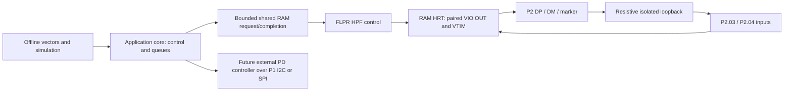

# SoftUSB architecture and verification boundaries

Status: 2026-10-15 design plus source inspection. **LS peripheral first; FS and host stretch only.** The present target is an isolated bench fixture. Protocol correctness precedes enumeration. No physical wiring confirmation, flash, real-host attachment or measured timing is claimed by this document. See `RESEARCH.md` for primary evidence, `WIRING.md` for exact revision-gated connections and `RESULTS.md` for the root thread's test record.

## Execution split

The app core owns configuration, HFXO request, command validation, logging after completion, application policy and eventual PD supervision. FLPR owns P2 waveform timing and eventual USB RX/transaction deadlines. HPF supplies the bare-metal control/HRT pattern; the stock GPIO API's cross-core calls are not a per-edge transport. [Nordic tagged HPF architecture](https://github.com/nrfconnect/sdk-nrf/blob/v3.4.1/doc/nrf/app_dev/device_guides/coprocessors/hpf.rst).

Use one request producer and one completion producer with one in-flight transaction initially. Shared structures carry fixed-width values, version/magic, sequence numbers, lengths and bounds; no pointers into one core's private memory. Publish filled requests with release semantics and consume with acquire semantics. Keep buffers immutable until completion. A compiler barrier alone is not a complete cross-core ordering contract. The actual memory map and linker reservations must agree for both images.

Current source ABI is **1**, magic `0x53554231`, maximum **1024 cells**. A cell packs `(period - 1) << 16 | OUT`; marker is VIO bit 1. The interface uses polling, no HRT IPC ISR. The current overlays partition app RAM as 144 KiB at `0x20000000`, shared IPC as 16 KiB at `0x20024000`, and FLPR RAM as 96 KiB at `0x20028000`; FLPR source RRAM is 96 KiB at `0x00165000`. The RAM regions are adjacent and non-overlapping, ending at `0x20040000`. These are source settings awaiting build/link and runtime validation, not proof that the images run. Check final generated maps before flashing.

## Implemented versus planned

This is a moving integration snapshot, not build certification. Research helper inspected these source files read-only; final build/test claims come from their owners.

| Layer | Source observed in this work | What that does not establish |
| --- | --- | --- |
| Bench IPC | `firmware/include/bench_ipc.h`: versioned fixed-width shared block, ARM/DISARM/TX commands, explicit key, cells and sample buffers | Runtime startup, placement or a functioning cross-core transfer |
| HRT transmitter | `firmware/flpr/src/hrt/hrt.c`: paired direct OUT CSR, CNT0 schedule, direction release, optional LS input samples | Measured bit periods, first/last-cell correctness, jitter or electrical safety under all faults |
| Pin assignments | DP VIO4, DM VIO0, marker VIO1; RX VIO3/VIO2 | Header routing, measured voltage or physical loopback |
| Portable protocol | Concurrent work owns `common/` and `tests/`; its final report is authoritative | An asynchronous hardware receiver or a live USB transaction engine |
| PD | Pin/peripheral reservation only | Controller selection, driver, policy or protected power path |
| FS/host | Timing analysis and stretch labels | USB-compliant FS or a host port |

Optional LS TX-time loopback samples read P2.03/04 after a fixed 16-NOP settling interval and compare a known outgoing schedule with a separate input path. That interval is an implementation choice, not a measured pad-settling guarantee. They are not asynchronous receive clock recovery, bus turnaround or a token/handshake test. Reading back OUT is not loopback. Synthetic line states and simulation results must be labeled as such.

## HRT contract and line states

The stable proposed mapping is P2.00 DP (VIO4), P2.01 DM (VIO0), P2.02 capture marker (VIO1), P2.03/P2.04 independent loop inputs (VIO3/VIO2). Only the three output roles may be set in the direction mask. FLPR claims pad ownership using `CTRLSEL=VPR`; the app and other peripherals must not write those pads concurrently. Preserve disabled/high-Z states while changing owner, input buffer, pull and drive configuration. The RX pads stay input-only.

For LS, J is DP=0/DM=1 and K is DP=1/DM=0; FS reverses J/K polarity. SE0 is both low. SE1 is both high and must be rejected as a transmitted state. The marker is a capture signal, distinct from the USB packet SYNC field. DP and DM update together through one complete OUT write so there is no deliberate intermediate SE0/SE1 between J and K. Disable automatic-clock shifting, which would commandeer VIO0/DM. [Nordic GPIO-to-VIO mapping and HRT](https://github.com/nrfconnect/sdk-nrf/blob/v3.4.1/applications/hpf/gpio/src/main.c).

Startup is DISARMED: no pull-up, output directions zero, no automatic TX, and no successful ARM implied by valid IPC startup. In the current source, ARM also leaves all pads as inputs; only an explicit TX command enables the three outputs, and TX releases them at completion. Drive is S0S1 only. Reject bad ABI, count, flags, unsupported speeds and SE1 before changing output directions. After each bounded operation and on errors, release DP/DM; report state after HRT. A controller reset/disarm must not leave a static driven bus. Hardware voltage/routing/user-confirmation gates sit outside software ARM: a magic key is only an accidental-command guard.

Precompute bounded symbol/cell arrays outside HRT. Within HRT, avoid C callbacks, allocation, printf, Zephyr ticks and mailbox dispatch. Use VTIM-anchored deadlines and direct VIO operations. Account for descriptor loads, branches, CSR effects and timer-reload semantics, especially first edge, final EOP and release. Keep HRT and data in RAM; validate instruction timing under realistic app-core memory/DMA load. No claim that every RISC-V instruction costs one cycle is justified by the core frequency alone.

## Timing decisions

At 128 MHz the tick is 7.8125 ns. LS needs 85 1/3 ticks per bit; a properly scheduled 85/85/86 sequence is a plausible starting point. FS needs 10 2/3 ticks, but 10/11/11 creates a -5.208 ns short cell. That exceeds the USB FS ±3.5 ns total next-transition budget when such a cell carries consecutive transitions. Its exact mean rate does not resolve the problem. FS is explicitly experimental and must not inherit LS validation. See the arithmetic and USB citations in `RESEARCH.md`.

FLPR/VTIM follow the configured app-core frequency, which can be 64 or 128 MHz. The current firmware source checks `PLL.CURRENTFREQ` for 128 MHz and retains an app-core HFXO request before enabling HRT. Its build has not yet been reported passing at this documentation snapshot; these checks still need runtime verification. Clock-frequency changes and releasing the crystal during a transfer are prohibited. Do not use CPU busy-loop count, J-Link speed or a generated DTS number as proof of the actual timebase. [VPR](https://docs.nordicsemi.com/r/bundle/ps_nrf54l15/page/vpr.html), [CPU frequency](https://docs.nordicsemi.com/r/bundle/ps_nrf54l15/page/chapters/oscillators.html-pll_desc), [VTIM guide](https://github.com/nrfconnect/sdk-nrf/blob/v3.4.1/doc/nrf/app_dev/device_guides/coprocessors/rt_peripherals.rst).

A future receiver must detect SOP, recover phase from transitions, sample away from crossover, recognize EOP/reset/invalid states and reject malformed traffic without replying. Validate drift through the maximum transition-free stuffed sequence. RX-to-TX response includes EOP recognition, validation/CRC, endpoint decision, direction switching and pad settling. Budget against the responder's inter-packet window, not a whole 1 ms frame. Keep immediate ACK/NAK/STALL and prepared IN data decisions on FLPR; an app-core IPC round trip is not an assumed deadline solution.

## Protocol milestones before enumeration

1. **Offline packet correctness:** independently known vectors for LS/FS J/K polarity, LSB order, NRZI, stuffing across field boundaries, PID complement, token CRC5 and data CRC16. Include empty payload, maximum LS packet, final required stuffed bit and malformed/truncated input.
2. **Isolated TX and independent loopback:** compare real DP/DM samples with source symbols; retain mismatches, not just a passing count. Inspect EOP and direction release. A probe attached to the source alone does not verify the separate RX wiring.
3. **Asynchronous receive:** source an independent, voltage-compatible stream with clock/phase variations; reject bad CRC/PID/stuff/EOP, wrong address and invalid lengths; distinguish reset and keep-alive. No real-host cable is implied by this stimulus requirement.
4. **Transaction correctness:** token/data/handshake ordering, address/endpoint filtering, endpoint halt, NAK, retries and duplicate DATA handling. Advance data toggle only at the protocol-defined successful completion; repeated packets must not duplicate application effects.
5. **Control pipe correctness:** new SETUP resets control sequencing; GET_DESCRIPTOR honors wLength and packet boundaries; SET_ADDRESS takes effect after the status stage; reset clears address/configuration/toggles. LS uses an 8-byte EP0 maximum packet and interrupt endpoints of at most 8 bytes, and starts with EP0 plus a small interrupt/HID function. Do not advertise bulk/isochronous endpoints for an LS device.
6. **Electrical and attach review, then enumeration:** pass the root thread's measured timing/voltage/release gates and obtain an explicit next-stage hardware plan/user action before installing attach signaling or a host cable. Enumeration success alone is not protocol or electrical compliance.

These are acceptance requirements, not claims that all tests exist or pass. The protocol helper owns implementation and test results. USB reference: [USB-IF USB 2.0 specification](https://www.usb.org/document-library/usb-20-specification), Chapters 7–9; accessible original text mirror recorded in `RESEARCH.md`.

## Concurrent PD without raw CC timing

The separate external controller owns CC analog signaling and PD hard real-time work. Prefer an autonomous controller owning PHY/protocol/policy so FLPR is never assigned BMC decode, GoodCRC generation, VCONN timing or PD power switching. App-core software handles controller configuration, status/IRQ, policy requests and bounded data transport. TPS25751 is a documented example of that division, not a selected part. A bare TCPC requires a different app-core policy/deadline budget. [TI standalone PD architecture](https://www.ti.com/lit/ds/symlink/tps25751.pdf).

Reserve **TWIM21** on P1.11/P1.12 and P1.04/P1.05 for IRQ/reset. **SPIM21** is an alternative using P1.11 SCK/P1.12 MOSI/P1.06 MISO/P1.07 CS. Serial21 aliases one hardware block: enable only the selected personality. The firmware overlay now disables UART20 and selects UART30/P0 for console; its default pinctrl uses P0.00/01 plus P0.02/03 RTS/CTS. P1 PD pins remain untouched by firmware. The future external-controller connection still requires checking/disconnecting debugger routes on P1.04–07. P1 buttons/LEDs and P2 soft-USB pins remain outside the PD reservation. Exact connector positions are in `WIRING.md`.

Proposed service budget, to refine with the selected controller: bounded I2C bursts (initial target <=32 data bytes at 400 kHz if supported) consume at least 0.72 ms for 32 bytes with ACK bits, plus address/register/start/stop and clock stretching. At 100 kHz that byte portion is 2.88 ms. These are calculated bus occupancy, not CPU time or guaranteed PD deadlines. Use asynchronous hardware transfer/DMA, short IRQ handlers and deferred status processing; no global IRQ masking for a USB packet on the app core. Characterize FLPR while generating representative controller IRQ and memory/DMA traffic. The controller's FIFO/alert specification must establish the actual worst-case service deadline; until a part is selected, concurrent PD is a reservation and test plan only.

The external protected power path handles connector VBUS and negotiated voltage. DK VDD/GPIO never connects directly to CC, VCONN or high-voltage VBUS. PD role negotiation does not implement USB data host mode. No host VBUS source, pulldowns, hub scheduling, SOF/keep-alive generation or role swap is implemented here. No ferrite bead is proposed; direct low-impedance rails with appropriate local decoupling remain the default.

## Evidence required for each capability claim

Record source revision, both-core image/configuration, board revision, routing selection, measured VDDIO, HFXO/current clock, probe wiring/load, instrument settings and raw capture path. Report separately: offline vectors, real loopback, asynchronous RX, transaction response, analog qualification and actual enumeration. Keep frequency error, source jitter, EOP duration, DP/DM skew and turnaround as separate measurements with uncertainty. The research thread neither owns Saleae nor edits `RESULTS.md`.
